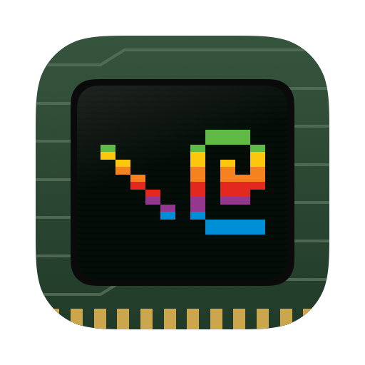
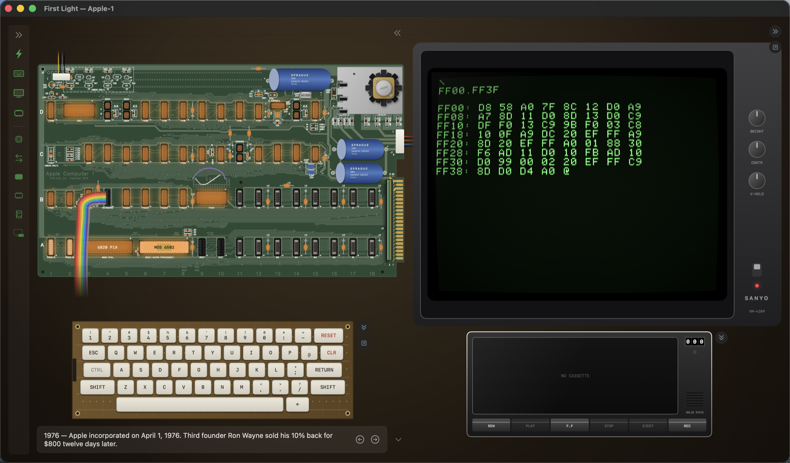

<p align="center"></p>

# First Light

<p>
<a href="https://github.com/d4rkwyng/first-light/releases/latest"></a>
<a href="https://github.com/d4rkwyng/homebrew-tap/blob/main/Casks/first-light.rb"></a>


<a href="LICENSE"></a>
</p>

A living Apple-1 for Apple's 50th anniversary. A native Mac app where the
1976 machine's board is visible chip-by-chip, peripherals connect by
drag-and-drop, and guided demos show what the $666.66 computer could do —
backed by a real, cycle-counted emulation.

Status: the full bench. The board is rendered from the original
fabrication files (copper, silkscreen, drill, outline gerbers) with
every chip socketed, pullable, and failing the way real hardware fails.
Around it: a Datanetics-style keyboard (clickable, era thock, no
auto-repeat — just like the real one), a Sanyo-style monitor with
working knobs (V-HOLD included) that detaches into its own window, and
a cassette deck that plays each tape's ACTUAL BYTES as bit-true ACI
audio while it loads. The cassette library holds the official 1976
catalog (Hamurabi, Microchess, Lunar Lander, Mini-Startrek, Mastermind,
Blackjack, the Dis-Assembler, the Extended Monitor, Integer BASIC, and
Life, the tape that came with the Apple-1) plus modern homebrew (15
Puzzle, 2048, APPLE 30TH, Mandelbrot 65, and APPLE 50TH) — all
machine-verified by `Scripts/verify-tapes.sh`. ⌘K opens
a command palette that types 1976 syntax for you; ⌘/ is the quick
reference; ⌘F is full-screen phosphor. VoiceOver can read the Apple-1
screen: the visible text and the cursor position. See
[docs/PLAN.md](docs/PLAN.md).

What's new: see the [changelog](CHANGELOG.md), or
[1.0.2](CHANGELOG.md#102---2026-11-23) for the latest release.



## Install

Download the latest notarized build from
[Releases](https://github.com/d4rkwyng/first-light/releases) — or build it
yourself below. Apple silicon only (there is no Intel build); requires
macOS 15 or later.

Or install with Homebrew. Homebrew asks you to trust a third-party tap
once before it loads its casks:

```sh
brew trust --tap d4rkwyng/tap
brew install --cask d4rkwyng/tap/first-light
```

## Custom cassettes

Cassettes ▸ Load Custom Cassette… (⌘O) loads your own tape:

- `.bin` — raw bytes, loaded at `$0300` and run. Put a hex address after
  an `@` in the name to load elsewhere: `game@0280.bin` loads at `$0280`.
- `.txt` in wozmon format (`0300: A9 00 …`) — each line goes to its
  address, and it runs from the first one. A tape that includes zero page
  is treated as an Integer BASIC program and started in BASIC.
- `.txt` of BASIC source — typed into Integer BASIC and `RUN`.
- A recording of a real Apple-1 tape — `.wav`, `.aif`, `.aiff`, `.mp3`,
  or `.m4a` — decoded from the ACI tones.

A tape can hold at most 64 KB, and a recording can run at most 10
minutes. A file that is too big, too long, unreadable, or a recording
with no Apple-1 tape data in it gets an alert that says so.

Cassettes ▸ Record to Cassette… saves a memory range as a wozmon-format
`.txt` (it loads straight back) plus a bit-true `.wav` of the ACI tones.
The BASIC-program preset saves only the `.txt`: a BASIC tape is two
ranges, pointers and program, so there is no single `.wav` for it.

## Build & test

Works with Command Line Tools only (no Xcode required), including the
newer Swift 6.4 / macOS 27 SDK toolchain:

```sh
./Scripts/test.sh                 # run the core test suite
./Scripts/build-app.sh            # build dist/First Light.app
./Scripts/build-app.sh --install  # ...and copy to /Applications
./Scripts/build-app.sh --smoke    # ...and launch-test it (Scripts/smoke-launch.sh)
swift run FirstLight              # or just run it directly
./Scripts/verify-tapes.sh         # load and check every library tape
./Scripts/verify-tapes.sh --verbose  # ...and dump each tape's transcript
```

Notarized releases are built by
[.github/workflows/release.yml](.github/workflows/release.yml). See
[RELEASING.md](RELEASING.md).

In the app: type at the Woz Monitor (try `FF00.FFFF`), ⌘B drops Integer
BASIC into RAM and starts it, ⌘R resets. Esc cancels a monitor line;
Delete sends `_`, the Apple-1's rubout.

## Credits & legal

First Light's own code is [MIT](LICENSE). The MIT license covers only our
original code — bundled historical ROM images, software cassettes, fonts,
board fabrication data, and photographs have their own owners and terms;
the full provenance record is in [NOTICE.md](NOTICE.md). The short version:

- 6502 core: [fake6502](http://rubbermallet.org/fake6502.c) v1.1 by Mike
  Chambers (public domain).
- Woz Monitor and Apple Integer BASIC are © Apple. They have circulated
  freely in the Apple-1 preservation community for decades and are included
  for education and preservation. Not affiliated with Apple Inc.
- Era software and cassette images collected from the Apple-1
  community: the Apple-1 Software Library (apple1software.com),
  Mike Willegal (willegal.net), and Applefritter.
- Apple-1 PCB gerbers from the Applefritter A1replica project; ACI
  card gerbers from github.com/kalinchuk/apple_1. The board you see is
  rendered from those fabrication files.
- 2513 character ROM glyphs from the P-LAB dump (CC BY 4.0).
- Photos (all CC BY-SA, Wikimedia Commons): Ed Uthman (Smithsonian
  Apple-1), Arnold Reinhold (Woz's Apple-1 at CHM), Jordiipa (CHM
  Apple-1), Sergei Magel/HNF (Heinz Nixdorf MuseumsForum setup).
